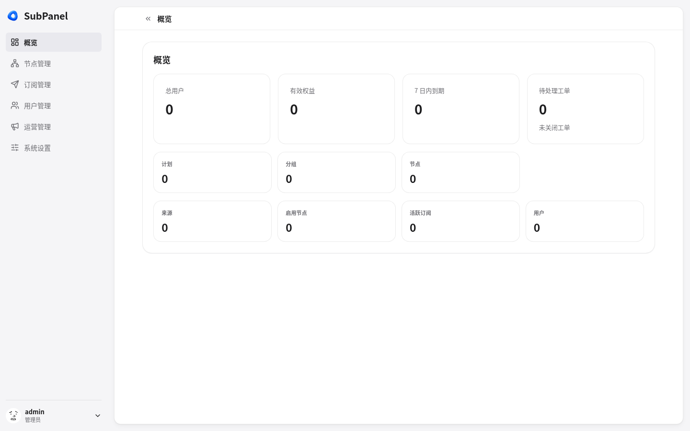
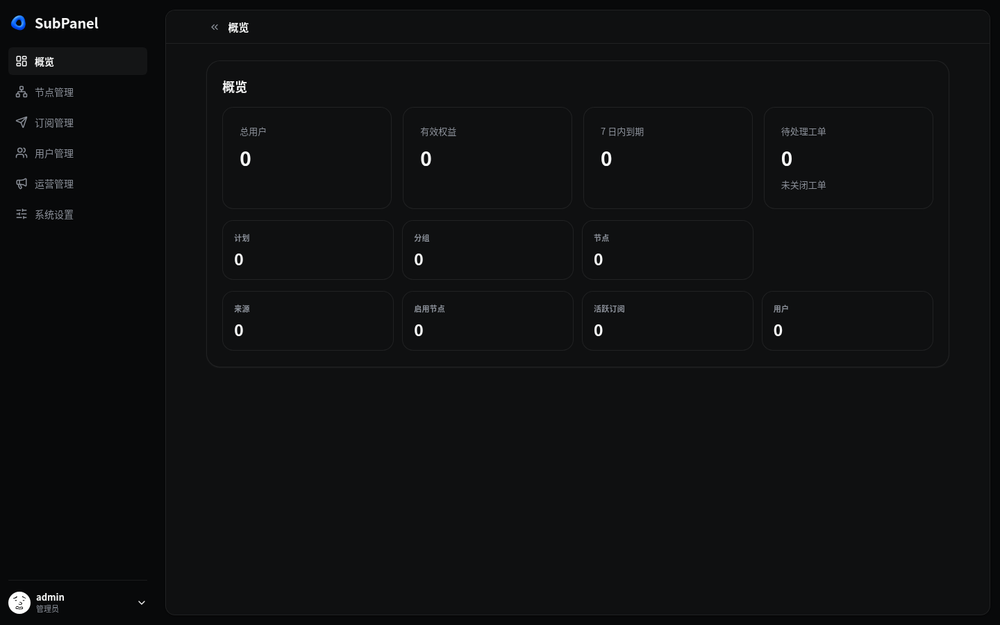
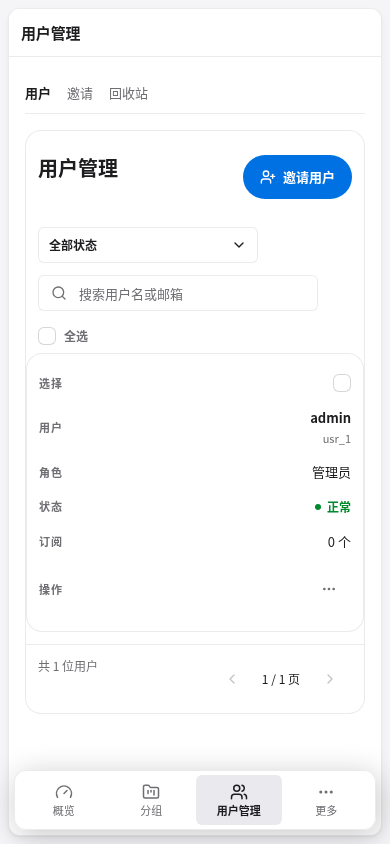

# SubPanel 沉浸式布局改造报告

基线 `bf9cc2d1`，分支 `task/immersive-shell`。范围只动管理端外壳（用户端走同一个 `AppShell`，因此同样套上浮层）。路由、接口、侧栏项样式、底栏、PageHero 和各页内部呈现没有改。

## 改了哪些文件

- `src/styles/tokens.css`：增加外壳令牌 `--space-shell`（14px）、`--radius-shell`（14px）、`--shadow-shell`（浅色极轻阴影，深色 1px 发丝阴影）。背景色仍用现有 `--color-canvas` / `--color-surface`。
- `src/styles/app.css`：外壳布局。侧栏容器去掉右边框；主区改成内嵌面板；滚动改到面板内部。
- `development/screenshots/immersive-shell/`：自查截图三张。

`src/app/AppShell.tsx` 和 `src/styles/admin-navigation.css` 没有改。侧栏 6 个入口、224px / 64px、项高 40px、图标 18px、选中浅底加粗、SectionTabs、账号区，都还是原来的标记和规则。

## 容器结构

DOM 仍是 `app-layout > sidebar + workspace(topbar + main.workspace-content)`。没有给侧栏加包裹层。

- 外层 `.app-layout` 锁在 `100svh`，背景 `--color-canvas`（浅 `#F5F5F7`，深 `#08090A`）。`body:has(.app-layout)` 禁止文档滚动。
- 侧栏直接铺在这块背景上：`border: 0`、`box-shadow: none`、`border-radius: 0`、背景与外层同色。导航仍是 `overflow-y: auto`，账号区仍是网格最后一行，贴在侧栏底部。账号行原有的 `border-top` 分隔线保留，那是侧栏内部样式，不是侧栏容器的框。
- 侧栏与面板之间用 `column-gap: 14px`。面板 `margin` 上、右、下各 14px，所以四边都不贴视口。
- `.workspace` 是内嵌面板：背景 `--color-surface`（浅色白，深色 `#0F1011`），圆角 14px，1px `--color-border`，加上 `--shadow-shell`。顶栏改成不透明的面板表面色，留在面板内部，不再用画布毛玻璃。
- `main.workspace-content` 是滚动容器（`overflow-y: auto`）。内容列仍按 `--size-content-max`（1080px）居中，横向留白用 padding 算出来，滚动条贴在面板内缘，不把整页撑出去。
- 窄屏（≤760px）：侧栏仍隐藏，底栏规则未改。面板四边收成 8px（`--space-2`），圆角收成 12px（`--radius-sheet`）。内容区原有的底栏避让 padding 还在。

## 自测

| 命令 | 结果 |
| --- | --- |
| `npm run check` | 通过（wrangler types、tsc、oxlint 0 警告） |
| `npm test` | 481/481 通过 |
| `npm run build` | 通过 |

## 截图结论

视口：桌面 1440×900，窄屏 390×844。Playwright（Chromium headless）量过计算样式，并保存截图。

桌面浅色（概览）：

- 侧栏宽 224px，6 个入口文案与顺序未变，项高 40px，图标 18×18，选中项字重 590、浅底 `rgb(233, 233, 238)`。账号区底边与侧栏底边重合。
- 侧栏四边边框 0、阴影 none、圆角 0，背景与外层同为 `rgb(245, 245, 247)`。
- 面板上/右/下/与侧栏间距都是 14px。面板白底、圆角 14px、边框 1px `rgba(0,0,0,0.08)`，阴影为 `0 1px 2px` 加 `0 4px 10px`（透明度 0.05 / 0.04）。顶栏在面板内部，高度 48px，背景白色。
- 概览统计卡仍是原来的卡片网格。

桌面深色：外层 `rgb(8, 9, 10)`，面板 `rgb(15, 16, 17)`，1px 浅边框和 14px 圆角仍在。侧栏无边框、无阴影，背景与外层相同。间距仍是 14px。深色阴影只有 `0 1px 2px rgba(0,0,0,0.45)`，观感上主要靠表面色和边框分开。

滚动：

- 往 `main.workspace-content` 写入 1800px 占位后，`scrollTop` 可到 480，文档 `scrollTop` 仍是 0，侧栏 `top` 仍是 0。滚动发生在面板内部。
- 视口高 360px 时，侧栏导航 `scrollHeight` 280、`clientHeight` 231，`scrollTop` 可到 49；滚动期间账号区底边差仍是 0。侧栏自己滚动，账号停在底部。

390px 浅色，用户管理页：

- 侧栏 `display: none`。底栏仍是 `display: flex`、高 60px、距底 14px。
- 面板四边间距 8px，圆角 12px，边框 1px。文档不滚动，滚动仍在面板内部。
- 用户表头 `display: none`，行 `display: block`，单元格 `display: flex`，`data-label` 为选择、用户、角色、状态、订阅、操作。卡片行还在，没有被压成表格。

节点管理页的 SectionTabs（节点 / 来源 / 分组）仍在面板内容里。

## 未验证项

- 没有单独截用户角色页面。用户端用同一个 `.workspace` 规则，导航、底栏和 PageHero 的标记没有改。
- 三张图都是侧栏展开态。收起宽度 64px 的规则在 `admin-navigation.css`，本次没改，也没有单独截收起态。
- 没有跑 `npm run test:e2e`。本次自查是上面的计算样式和三张截图。
- 主题菜单的 `popover` 顶距按面板内边改过，没有单独截菜单弹出层。
- 深色阴影在截图里几乎看不出来，深色区分靠表面色和边框。
