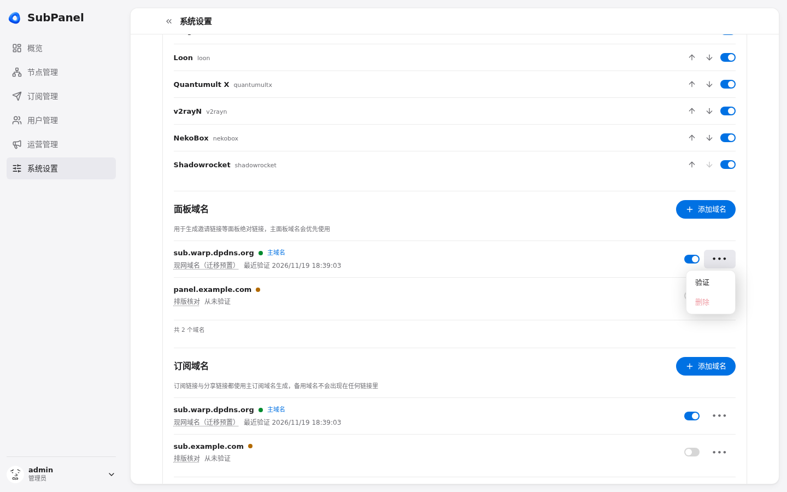

# 排版层级扁平化（去卡中卡）

基线 `a818d3a7`，分支 `task/layout-flatten`。只改了 tsx 结构与 CSS：文案、路由、数据、接口、颜色令牌都没有动。来源页没有改功能结构。

桌面卡片内边距用字面 `20px`（现行令牌没有 20px，`--space-5` 是 24px）。窄屏（≤760px）用 `--space-4`（16px）。层级只用已有字号令牌。

## 测试

| 阶段 | check | vitest | 页面测试 | build |
| --- | --- | --- | --- | --- |
| 改前 | — | 57 文件 / 481 | 14 文件 / 189 | — |
| 改后 | 通过 | 57 文件 / 481 | 14 文件 / 189 | 通过 |

计数没有下降。日志在 `/tmp/groklayout.log`。

## 订阅分发（点名页）

改前：页卡里再套「域名与平台展示」边框区块，每个平台一行一个四边框盒子，域名行 ••• 里的「删除」是带边框的红字按钮。计算样式：`.data-section` 与 `.dom-platform-row` 的 `border-top/right` 都是 `1px`；删除项 `border: 1px solid rgba(0,0,0,0.08)`，颜色 `rgb(215, 0, 21)`。

改后：外层只留一张系统设置卡。区块改成标题加内容，区块之间用间距和发丝线。平台行、域名行都是通栏发丝线，右侧操作 `flex: none`，名称可收缩。1440 下平台开关距卡片右缘 21px，未裁切。390 下距右缘 17px，开关右缘在 348 / 390，未裁切，长名称换行而不是把开关推出视口。

域名行菜单（删除为纯红字，无边框、无底）：

改后计算样式：菜单项 `border-top: 0px none`，背景透明；「删除」颜色仍是 `rgb(215, 0, 21)`。悬停只铺 `--color-surface-subtle`。弹出层本身仍是菜单容器。

对照截图：

- 改前 1440：`development/screenshots/layout-flatten/before-distribution-1440.png`
- 改前 390：`development/screenshots/layout-flatten/before-distribution-390.png`
- 改前菜单：`development/screenshots/layout-flatten/before-distribution-menu-1440.png`
- 改后 1440：`development/screenshots/layout-flatten/after-system-distribution-1440.png`（整页 1440×3093）
- 改后 390：`development/screenshots/layout-flatten/after-system-distribution-390.png`（整页 390×3891）

整页图是把工作区滚动容器展开后截的，固定底栏会画在视口位置上，这是拼接方式，不是页面又套了一层卡。

## 逐页改动

同一套规则落在 CSS 上，下面按页面写实际效果。

| 页面 | 改动 |
| --- | --- |
| 概览 `/dashboard` | 概览卡里的统计块、提醒去掉边框、圆角和底色，只留标题和数字；提醒与统计之间用发丝线 |
| 来源 `/catalog/sources` | 未改 tsx。资源卡内边距改为 20px / 16px；批量条去掉底盒；窄屏表格不再变成卡中卡。空状态盒保留 |
| 节点 `/catalog/nodes` | 与来源相同的资源卡内边距、批量条和窄屏表格 |
| 分组 `/catalog/groups` | 同上 |
| 客户端下载（管理）`/catalog/apps` | 列表仍是并列的页卡。编辑抽屉里的平台配置从逐张小卡改成发丝线网格 |
| 订阅（管理）`/delivery/subscriptions` | 窄屏（≤1100px）表格行从圆角盒改成发丝线 |
| 分享（管理）`/delivery/shares` | 同上，空单元格也不再画虚线盒 |
| 权益计划 `/plans` | 计划表与试用设置本来就是两张并列页卡，未再套内卡。页卡内边距随 `.ops-card` 改为 20px / 16px |
| 工单（管理）`/delivery/tickets` | 列表卡是并列卡片，保留。会话里的气泡改为通栏发丝线；撰写区桌面内边距 20px，窄屏 16px |
| 公告（管理）`/operations/notices` | 公告卡是并列卡片，未改成嵌套。页卡内边距同上 |
| 知识库（管理）`/kb/manage` | 正文 `pre` / `code` 作为代码块保留 |
| 用户 `/users` | 窄屏卡片内边距改为 16px。行菜单原先已是无边框文字行。窄屏表格不再做成独立圆角行卡 |
| 邀请 `/invites` | 邀请码列表与邮箱白名单共用的条目从带框小盒改成发丝线行 |
| 回收站 `/users/recycle-bin` | 与用户卡同一套内边距 |
| 审计 `/audit-logs` | 诊断条目从独立盒子改成发丝线行 |
| 注册设置 `/system/registration` | 去掉页卡内的 `data-section` 边框和底色。白名单与「暂无」提示不再用虚线盒。区块之间发丝线 |
| 邮件设置 `/system/mail` | 同一张系统卡。模板区去掉额外的左右缩进，模板行保持发丝线 |
| 订阅分发 `/system/distribution` | 见上。域名块的根类从 `ops-card sys-domain-card` 改为 `sys-domain-block`，只去掉内卡壳，按钮和文案不变 |
| 运行状态 `/system/status` | 模块状态、迁移记录从带框条目改成发丝线行 |
| 账户 `/account` | 页卡内边距 20px / 16px，没有新的内卡 |
| 首页 `/home` | 统计卡、快捷入口是画布上的并列卡片，保留 |
| 权益 `/entitlement`、权益列表 `/entitlements` | 并列卡片保留 |
| 我的 `/me` | 账户、通知、计划、安全是并列卡片，保留 |
| 我的订阅 `/subscriptions` | 到期提醒外层盒子去掉边框和底色。分享抽屉里的表单不再套一层盒；链接展示块保留 |
| 用户节点 `/nodes` | 窄屏本来就拿掉外卡，行保持在壳里 |
| 公告、知识库、工单、客户端下载（用户） | 列表卡、空状态盒保留。工单消息气泡改为发丝线。用户端平台条如果出现，不再是逐张小卡 |
| 登录 `/login`、注册 `/register` | 一张认证卡，未改样式 |

••• 与批量「更多」菜单全站共用一套：项无边框、无底，悬停才有浅底；危险项只有红字。覆盖管理端行菜单（`OperationsActions`）和批量菜单（`BatchToolbar`）。用户行菜单、资源卡菜单原来已是这个样式，没有再加边框。

## 保留的容器

| 保留 | 理由 |
| --- | --- |
| 空状态 `.sp-empty`、错误态 `.sp-error` | 简报允许的空态容器。来源页「暂无来源」、用户端「暂无可用的 APP」仍是这一层 |
| 对话框、抽屉外壳 | 本身就是容器。抽屉里的平台配置小卡已去掉 |
| `.sh-reveal`、链接条、令牌条、`.source-preview`、知识库与模板 YAML 的 `pre` | 链接或代码展示块 |
| 表单控件、分页按钮的边框 | 控件描边，不是卡片 |
| 菜单弹出层外壳 | 菜单容器。里面的项，包括「删除」，没有边框和底 |
| 首页统计、我的账户卡、公告卡、工单列表卡、计划卡、客户端下载卡、认证卡 | 画布上的并列卡片，不是卡中卡 |
| 客户端下载设置卡（应用管理页下半，不在 `.ops-system` 里） | 与上半列表并列的页卡，不是套在另一张卡里 |
| 颜色令牌与全部文案 | 按简报不动 |

来源页只吃到资源卡内边距、批量条和窄屏表格这三处必要扁平化，没有改它的功能结构。

## 截图目录

`development/screenshots/layout-flatten/`，管理端与用户端路由各有 1440 与 390。文件名 `before-*` 是订阅分发改前，`after-*` 是改后。自查结论：点名页不再卡中卡，开关不贴边、不裁切，域名行「删除」是纯红字。其余已截页面的计算样式没有再检出「卡内还套着四边框或带圆角底色的子卡」，也没有检出被视口裁切的开关。

公开分享页需要一条真实分享令牌，这次本地库没有可分享的订阅，所以没有单独截分享落地页。邀请链接会进注册页，注册页已截。
